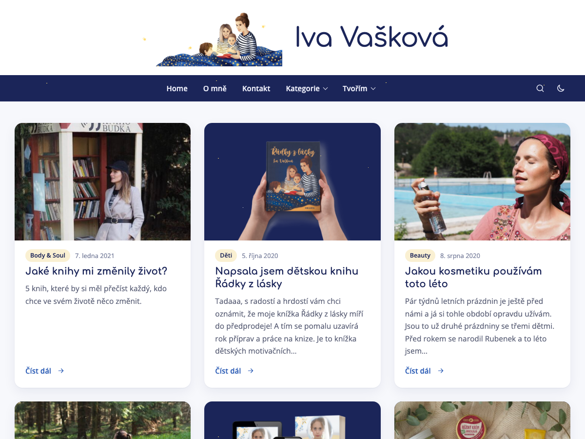

# Iva Vašková — WordPress šablona a plugin

[](https://github.com/elvisek2020/wp-theme_ivavaskova/releases/latest)


Vlastní lehká šablona a plugin pro osobní web [www.ivavaskova.cz](https://www.ivavaskova.cz), které nahrazují starou šablonu Dollah a většinu pluginů.



| Balíček | Typ | Popis |
|---|---|---|
| `ivavaskova-core` | plugin | funkce nezávislé na šabloně (bezpečnost, údržba, sitemap, ochrana obsahu) |
| `ivavaskova` | šablona | vzhled „Hvězdná noc“ (světlý i tmavý režim, SEO, GA4 s cookie lištou, lightbox) |

Oba balíčky se vydávají společně se stejnou verzí.

## Šablona Iva Vašková

**Vzhled**
- „Hvězdná noc“: barvy z ilustrace v logu — tmavě modrý pruh menu a patička se zlatými hvězdičkami, zaoblené karty článků
- světlý i tmavý režim: podle zařízení, nebo ručně přepínačem Systém / Světlý / Tmavý v patičce (volba se pamatuje)
- písma Comfortaa a Open Sans uložená přímo v šabloně
- plně responzivní: menu pod tlačítkem, podmenu klepnutím

**Články**
- lightbox na fotky a galerie (šipky, klávesnice, přejetí prstem)
- externí odkazy do nového okna, videa YouTube přes celou šířku
- štítky, odkazy na sousední články, komentáře s antispamem bez reCAPTCHA

**Technicky**
- hybridní šablona (PHP + `theme.json`), bez jQuery a bez build kroku
- SEO: meta description, Open Graph, JSON-LD
- GA4 s Consent Mode v2 a vlastní cookie lištou
- při přepnutí z Dollah převezme menu a logo; dokud běží staré pluginy, nic nevypisuje dvakrát

| Nastavení (Vzhled → Přizpůsobit) | Volby |
|---|---|
| Identita webu | logo (ilustrace), název webu |
| Menu | Hlavní menu, Menu v patičce |
| Iva Vašková | Instagram, Facebook, YouTube, text v patičce, ID Google Analytics 4 |

## Plugin Iva Vašková Core

Nahrazuje 6 dřívějších pluginů a funguje nezávisle na šabloně.

| Oblast | Co dělá |
|---|---|
| Přihlášení | limit 5 chybných pokusů / 15 min → blokace IP na 30 min, neutrální chybová hláška |
| Log přihlášení | Nástroje → Log přihlášení (200 posledních pokusů), sloupec Poslední přihlášení u uživatelů |
| Administrace | verze PHP a DB, IP serveru a paměť v patičce |
| Aktualizace | automatické aktualizace WordPressu, pluginů, šablon a překladů; plugin samotný z GitHub Releases |
| Ochrana obsahu | bez pravého tlačítka, kopírování a přetahování obrázků pro nepřihlášené (Nastavení → Obecné) |
| Zabezpečení | vypnuté XML-RPC, skrytí uživatelů v REST, přesměrování autorských archivů, HTTP hlavičky |
| Sitemap a AI | `/wp-sitemap.xml` bez uživatelů, `/llms.txt` |

**Údržba webu** (Nástroje → Údržba webu):
- databáze: velikost tabulek, autoload, optimalizace
- tabulky po vypnutých a odebraných pluginech (smazání vybraných)
- největší a nepoužité obrázky, rozbité interní odkazy
- revize, koncepty a koš, transienty
- widget **Zdraví webu** na Nástěnce

## Požadavky

- WordPress 6.5 nebo novější
- PHP 7.4 nebo novější

## Instalace

1. Z [posledního vydání](https://github.com/elvisek2020/wp-theme_ivavaskova/releases/latest) stáhni `ivavaskova-core.zip` a `ivavaskova.zip`.
2. V administraci: **Pluginy → Instalace pluginů → Nahrát plugin** → `ivavaskova-core.zip` → Aktivovat.
3. **Vzhled → Šablony → Přidat novou → Nahrát šablonu** → `ivavaskova.zip` → Aktivovat.

## Aktualizace

Plugin i šablona se aktualizují z GitHub Releases přes běžnou obrazovku aktualizací WordPressu.

## Vývoj

```
plugins/ivavaskova-core/   plugin (must-have)
theme/ivavaskova/          šablona
dev/                       lokální WordPress v Dockeru (PHP 7.4), viz dev/README.md
.github/workflows/         vydání z tagu vX.Y.Z → ZIPy do GitHub Release
```

Vydání: zvednout verzi v hlavičce pluginu i ve `style.css` šablony, zapsat `CHANGELOG.md`, commit, tag `vX.Y.Z`, push commitu i tagu.
